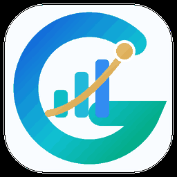

# Muhammad Haseeb

**Building useful software for AI, Linux desktops, developer workflows and ecommerce.**

I turn repetitive work into practical tools — from local-first AI and browser automation to WordPress, WooCommerce and desktop applications.

**[Advertpreneur](https://advertpreneur.com)** · **[LinkedIn](https://www.linkedin.com/in/muhammad-haseeb-pk)** · **[All repositories](https://github.com/haseebgb92?tab=repositories)**

---

## Start with these projects

<table>
<tr>
<td width="50%" valign="top">

### [AURA Download Manager](https://github.com/haseebgb92/AURA-Download-Manager)

A download manager for **Linux and Windows**, with aria2 acceleration, automatic Chrome/Firefox handoff, and control over when images stay in the browser.

[Product site](https://haseebgb92.github.io/AURA-Download-Manager/) · [Latest release](https://github.com/haseebgb92/AURA-Download-Manager/releases/latest)

</td>
<td width="50%" valign="top">

### [ChatGPT MCP Bridge](https://github.com/haseebgb92/ChatGPT-MCp)

A local-first bridge between ChatGPT and **approved files, terminal commands and your existing browser session** through secure MCP connections.

[Product site](https://haseebgb92.github.io/ChatGPT-MCp/) · [Latest release](https://github.com/haseebgb92/ChatGPT-MCp/releases/latest)

</td>
</tr>
<tr>
<td width="50%" valign="top">

### [GSC Maestro — Search Intelligence](https://github.com/haseebgb92/GSC-Maestro)

A **local-first SEO and search intelligence desktop app** for Google Search Console, Bing Webmaster and Yandex Webmaster, combining performance insights, indexing, technical audits and MCP reports.

**Linux / Tauri + React + Rust** · Repository being published

</td>
<td width="50%" valign="top">

### [WP Lab — WordPress Sandboxes](https://github.com/haseebgb92/WP-Lab)

Run disposable **WordPress and WooCommerce environments** with Docker, PHP switching, email testing, logs and client previews.

[Product site](https://haseebgb92.github.io/WP-Lab/) · [Latest release](https://github.com/haseebgb92/WP-Lab/releases/latest)

</td>
</tr>
</table>

## AI tools for business workflows

| Project | What it solves |
| --- | --- |
| **[Advertpreneur Connect](https://github.com/haseebgb92/advertpreneur-connect)** | A controlled AI-to-WordPress and WooCommerce bridge for content, media, SEO and quality-gated publishing. [Web app](https://advertpreneur-connect.vercel.app) |
| **[Image Commerce](https://github.com/haseebgb92/image-commerce)** | An AI workflow for realistic ecommerce product imagery and marketplace-oriented image planning for Amazon, Etsy, Shopify and more. |
| **[Codex Unchained](https://github.com/haseebgb92/codex-unchained)** | A Rust project that preserves the official Codex CLI workflow while enabling alternative inference backends. |

## Projects in active development

| Project | Direction |
| --- | --- |
| **[Tyrion — The Hand](https://github.com/haseebgb92/Tyrion-The-Hand)** | Local-first operations command center for tasks, approvals, schedules, MCP integrations and companion devices. *In development.* |
| **[Meta Manager](https://github.com/haseebgb92/meta-manager)** | Desktop social publishing and scheduling for Facebook, Instagram and LinkedIn, with a content calendar and local automation. [Latest public release](https://github.com/haseebgb92/meta-manager/releases/tag/v0.1.11) |

## The problems I like solving

**Local-first AI** · **Desktop automation** · **MCP integrations** · **Browser workflows** · **Linux tools** · **Search analytics & SEO** · **WordPress / WooCommerce** · **Ecommerce productivity**

I work at the intersection of product development, practical automation and commerce technology through **[Advertpreneur](https://advertpreneur.com)**.

### Explore, contribute or collaborate

Try a release, open a reproducible issue, share a practical use case, or contribute a fix. Please review each repository's license and contribution guidance before reusing code: public source does not always mean an open-source license.

For development partnerships, integrations or technical collaboration, reach out through **[Advertpreneur](https://advertpreneur.com)** or **[LinkedIn](https://www.linkedin.com/in/muhammad-haseeb-pk)**.

---

Advertpreneur · Commerce. Growth. Technology.

